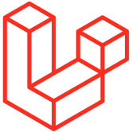

<div align="center">


<h1>Laravel Starter Kit · React + HeroUI</h1>
</div>

Each branch contains a starter kit. The `react/heroui` branch includes registration, login, password resets, email verification, 2FA, and passkeys.

## Tech stack

- The backend uses PHP 8.4, Laravel 13, and Fortify.
- The frontend uses React 19, Inertia 3, TypeScript, HeroUI 3, and Tailwind CSS 4.

## Local development

You'll need Git, Composer, PHP 8.4, Node.js 24 (24.11 or later), and pnpm 12.21.0.

1. Clone the `react/heroui` branch from GitHub.

    ```bash
    git clone --branch react/heroui --single-branch https://github.com/HungNth/laravel-starter-kit.git
    cd laravel-starter-kit
    ```

2. Install dependencies and create your `.env` file.

    ```bash
    composer install
    php -r "file_exists('.env') || copy('.env.example', '.env');"
    php artisan key:generate --no-interaction
    pnpm install --frozen-lockfile
    ```

3. Set your database connection in `.env`, then run the migrations and start the app.

    ```bash
    php artisan migrate --no-interaction
    composer run dev
    ```

    Open the address Laravel prints in the terminal. The default is `http://localhost:8000`. When you try signing up locally, look for the email verification link in `storage/logs/laravel.log`.

## Private homelab deployment

You'll need Docker Engine with Compose, Nginx Proxy Manager on the Docker network `proxy`, and a NetBird DNS record that points your internal hostname to the proxy. Keep the proxy accessible only to your private network.

1. Clone the deployment branch and create your runtime configuration.

    ```bash
    git clone --branch deploy/homelab --single-branch https://github.com/HungNth/laravel-starter-kit.git
    cd laravel-starter-kit
    cp -n .env.homelab.example .env.homelab
    chmod 600 .env.homelab
    docker run --rm php:8.4.27-cli-trixie php -r 'echo "base64:", base64_encode(random_bytes(32)), PHP_EOL;'
    ```

    In `.env.homelab`, set `APP_URL` to your internal HTTP URL, such as `http://laravel.example.internal`. Set `APP_KEY` to the generated value and keep it when recreating or upgrading containers. Set a strong `DB_PASSWORD`. The database and app user both default to `laravel`. Set `DB_DATABASE` and `DB_USERNAME` to customize them. For MariaDB, set a separate strong `MARIADB_ROOT_PASSWORD` for local database administration. Fill in the SMTP host, port, sender, and any credentials your SMTP server requires. Use `MAIL_SCHEME=smtps` if your server uses implicit TLS. Single-quote passwords with literal dollar signs.

2. Choose one database for the deployment. The command below uses PostgreSQL 18. For MariaDB 11.8, replace `docker-compose.postgresql.yaml` with `docker-compose.mariadb.yaml`. Both options use the same proxy hostname. Build the app image and run the migrations before starting the app.

    ```bash
    compose() {
        docker compose --project-name laravel-homelab --env-file .env.homelab \
            --file docker-compose.postgresql.yaml "$@"
    }

    compose build app &&
    compose up --detach --wait db &&
    compose run --rm --user www-data app php artisan migrate --force --no-interaction &&
    compose up --detach --wait
    ```

    Compose keeps Laravel files and database data in named volumes. Keep the same Compose file, project name, and volumes when recreating containers.

3. Add a Proxy Host in Nginx Proxy Manager using the hostname from `APP_URL`. Set **Scheme** to `http`, **Forward Hostname / IP** to `laravel-homelab`, and **Forward Port** to `80`. From a NetBird-connected device, open `/up` on your internal host and confirm it returns HTTP 200. Open `/login` to check that the page loads with styling, then exercise registration, 2FA, and password reset. The verification and reset emails should link back to your internal HTTP URL.

### Homelab upgrades

Back up the named volumes and your runtime configuration before upgrading. From the deployment checkout, define `compose()` as shown in step 2 with the Compose file you used to install. Then run the commands below.

```bash
git pull --ff-only &&
compose pull db &&
compose build --pull app &&
compose stop app &&
compose up --detach --wait db &&
compose run --rm --user www-data app php artisan migrate --force --no-interaction &&
compose up --detach --wait
```

The app starts after the migration succeeds. Recheck `/up` and sign in before resuming traffic. Ordinary starts and restarts leave migrations for the operator to run.

## Tooling

- pnpm installs frontend dependencies. [Vite+](https://viteplus.dev/guide/check) runs the dev server, builds assets, formats code, and runs the linter.
- Pint formats PHP, Larastan runs static analysis, and Pest runs tests.
- Wayfinder generates TypeScript functions for Laravel routes. Run `composer ide` to generate IDE hints with Laravel IDE Helper.
- Find the Laravel Boost and HeroUI MCP configuration in [`.agents/mcp_config.json`](.agents/mcp_config.json).

### Frontend commands

| Command                | What it does                                                            |
| ---------------------- | ----------------------------------------------------------------------- |
| `pnpm run dev`         | Start Vite+ on its own. `composer run dev` starts it alongside Laravel. |
| `pnpm run build`       | Build frontend assets for production.                                   |
| `pnpm run build:ssr`   | Build both Inertia's client and SSR bundles.                            |
| `pnpm run check`       | Check formatting and run the Vite+ linter.                              |
| `pnpm run check:fix`   | Apply formatting and available lint fixes.                              |
| `pnpm run types:check` | Check TypeScript types with `tsc --noEmit`.                             |
